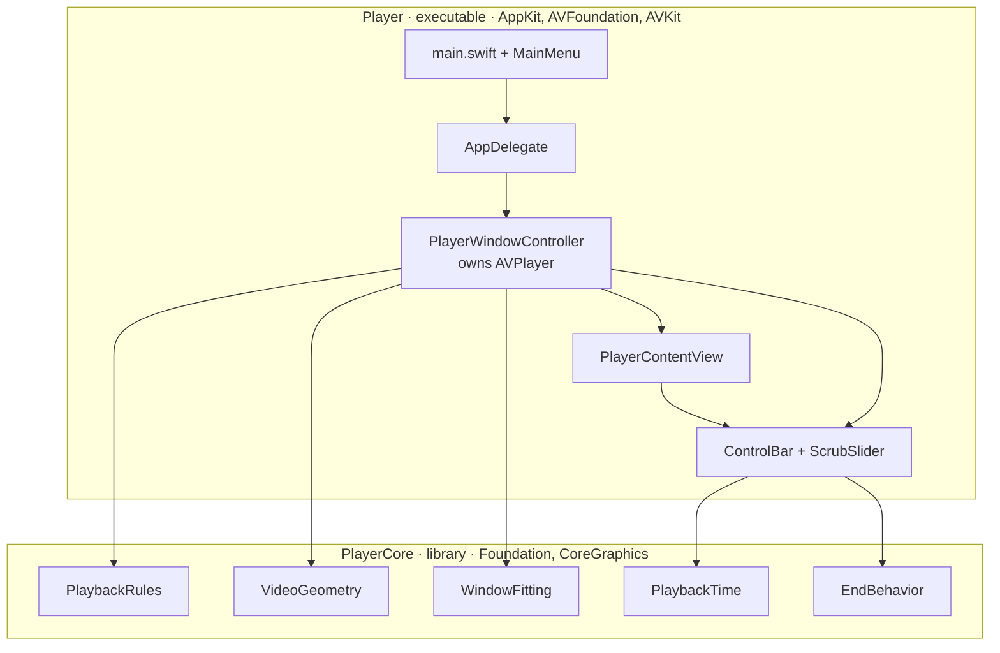

# Framewing

A small native macOS video player for simple, precise playback. Built with Swift 6, AppKit and AVFoundation: no third-party dependencies, 40 interface languages, and a tested core.

*Framewing* (FRAME-wing) is a frame on wings: a light player that stays out of the way of the video.


## Features

- Opens MP4, MOV and M4V files from Finder (double-click or **Open With**) or with **⌘O**.
- Play and pause, frame-accurate scrubbing, elapsed time and duration.
- Three end-of-video modes: **Stop** on the last frame, **Loop**, or go back **To start**.
- The window resizes to fit the video, up to 80% of the screen, and honours rotation metadata.
- The interface comes in 40 languages, picked from the system language, with English as the fallback. AppKit's own UI, such as the open panel and right-to-left layout for Arabic and Hebrew, follows the same choice.

## Requirements

- macOS 14 Sonoma or later
- Xcode 16 or later (Swift 6 toolchain)

## Build and run

```sh
./build.sh
open build/Framewing-dev.app
```

`build.sh` makes a release build and assembles the local development app `build/Framewing-dev.app` (binary, `Info.plist` and every `.lproj` folder), signed ad hoc. It has its own name and bundle identifier, `io.github.ruslan-palahin.framewing.dev`, so macOS never mixes it up with another copy of Framewing.

`swift run` starts the bare executable without an app bundle, so the interface shows localization keys instead of text. Use `build.sh` to run the app.

## Usage

| Action | How |
|---|---|
| Open a video | ⌘O, or double-click a file in Finder |
| Play / pause | The play button |
| Seek | Drag the slider |
| End-of-video mode | Stop / Loop / To start in the control bar; the choice carries over to the next video |
| Close, hide, quit | ⌘W, ⌘H, ⌘Q |

When Finder passes several files at once, the first one opens. Closing the window quits the app.

## Architecture

Two targets and one rule: rules and calculations on plain values live in the core; AppKit, AVFoundation and side effects live in the app.



- **PlayerCore** makes the decisions: what happens when a video ends, whether Play starts over, how the window fits a video, how time is shown. It holds plain value types with `package` access: no AppKit or AV frameworks, no I/O, no localized strings. SwiftPM cannot restrict system imports, so `CoreImportsTests` enforces the rule.
- The **Player** target is the AppKit shell. `PlayerWindowController` is the only owner of `AVPlayer`, the load task and the observers. It asks the core what to do and does it. Views take data and expose controls, and the controller wires up their actions.
- **Localization** lives in `Resources/<lang>.lproj`. `build.sh` copies it into the main app bundle rather than shipping a SwiftPM resource bundle, because AppKit picks the language of its own UI and the layout direction from the main bundle's localizations.

Where new code goes:

- A rule or calculation on plain values goes to `Sources/PlayerCore/<Concept>.swift`, with tests in `Tests/PlayerCoreTests/<Concept>Tests.swift`.
- Anything that touches AppKit, AVFoundation, files, preferences or timers, and every localized string, goes to `Sources/Player/`. Display text for a core type goes to `<CoreType>+Text.swift`.
- A new target is added only when code gets a second consumer.

## Localization

Arabic, Bulgarian, Catalan, Chinese (Simplified and Traditional), Croatian, Czech, Danish, Dutch, English, Estonian, Finnish, French, German, Greek, Hebrew, Hindi, Hungarian, Indonesian, Italian, Japanese, Kazakh, Korean, Latvian, Lithuanian, Malay, Norwegian Bokmål, Polish, Portuguese (Brazil and Portugal), Romanian, Russian, Slovak, Slovenian, Spanish, Swedish, Thai, Turkish, Ukrainian and Vietnamese.

To add a language:

1. Copy `Resources/en.lproj` to `Resources/<code>.lproj` and translate the values, keeping every key.
2. Add the code to `supportedLanguages` in `Tests/LocalizationTests/LocalizationTests.swift`.
3. Run `swift test`.

To add a string, add its key to every table; the tests list anything missing. Interpolate only strings in `String(localized:)`: each one becomes `%@` in the key, as in `"message.unplayable %@"`.

Translations other than English and Russian have not been reviewed by native speakers yet. Corrections are welcome.

## Testing

```sh
swift test
```

| Suite | What it checks |
|---|---|
| `PlaybackRulesTests` | End-of-video modes, starting over after Stop, reset on seek and on a new video |
| `PlaybackTimeTests` | `m:ss` formatting, negative and non-finite input |
| `VideoGeometryTests` | Display size of rotated video tracks |
| `WindowFittingTests` | Fitting into 80% of the screen, the minimum size, keeping the window on screen |
| `CoreImportsTests` | The core imports only Foundation and CoreGraphics and holds no localized strings |
| `LocalizationTests` | All 40 tables parse and have the same keys as English and as the code; no duplicates or empty values; placeholders match |

Playback, layout and system panels need a running app and are checked by hand:

- [ ] Launch without a file: the hint is shown.
- [ ] Open with ⌘O, cancel the panel, open from Finder.
- [ ] An unsupported or broken file shows an error message.
- [ ] Play, pause, scrub while playing.
- [ ] Each end-of-video mode; Play after Stop starts from the beginning.
- [ ] Open another file while one is loading: only the last one plays.
- [ ] A portrait video fits the screen; full screen keeps its size.
- [ ] `open -n build/Framewing-dev.app --args -AppleLanguages '(de)'`, then `'(ar)'` for right-to-left.

## Project structure

```text
Package.swift
Sources/
  PlayerCore/          rules and calculations
  Player/              AppKit app
Tests/
  PlayerCoreTests/
  LocalizationTests/
Resources/             Info.plist and 40 <lang>.lproj folders
build.sh               builds and signs build/Framewing-dev.app
```

## Limitations

- Signed ad hoc and not notarized. On another Mac, Gatekeeper blocks the first launch until it is allowed in System Settings → Privacy & Security.
- Built only for the architecture of the build machine.
- Plays what AVFoundation can decode.

## License

MIT. See [LICENSE](LICENSE).
